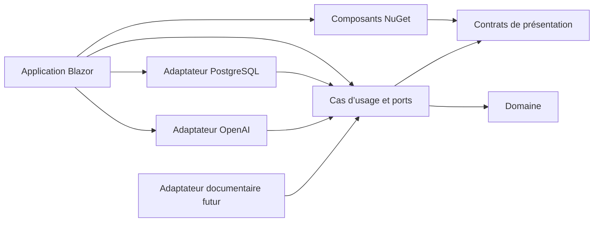

# Architecture — Marmotte.ChatUi

[English](ARCHITECTURE.md) | Français

## Statut et objectif

Ce document formalise l’architecture cible et les décisions de cadrage. À ce stade, le dépôt contient de la documentation et des ressources graphiques ; l’application et les packages ne sont pas encore implémentés ou publiés.

Marmotte.ChatUi vise deux usages : une application de chat en .NET et Blazor, inspirée d’AnythingLLM et d’Open WebUI, et une bibliothèque de composants et widgets intégrables dans d’autres applications. L’application complète utilisera les mêmes composants que ceux distribués en NuGet.

## Périmètre et étapes

### Première version

- Interface de chat, conversations, messages et affichage progressif des réponses lorsque le serveur le permet.
- Paramètres de connexion à des API compatibles OpenAI : [LM Studio](https://lmstudio.ai/docs/app), [Unsloth Desktop](https://www.unsloth.ai/) et endpoint personnalisé.
- Historique des conversations et préférences propres à chaque utilisateur.
- Authentification OIDC de l’application complète via Keycloak.
- Orchestration locale avec .NET Aspire, Keycloak et PostgreSQL muni de pgvector.
- Composants Blazor réutilisables destinés à un package NuGet.
- Design system personnalisable avec modes clair, sombre et système.
- Import de pièces jointes par sélection et glisser-déposer ; images envoyées aux modèles acceptant la vision.

### Étape suivante

Le traitement des PDF, en particulier scannés, est prévu mais peut suivre la première version. Il préparera des images de pages, avec sélection et limites de résolution, avant l’envoi à un modèle de vision. Un type de fichier sans traitement disponible ne devra pas être présenté comme exploitable par le modèle.

Le RAG, l’indexation documentaire et la génération d’embeddings ne sont pas inclus dans la première version. La disponibilité de pgvector prépare leur éventuelle évolution sans les implémenter. PostgreSQL est le seul fournisseur de persistance retenu pour le moment ; RavenDB n’est pas prévu dans ce périmètre.

## Principes structurants

Adopter une architecture hexagonale avec un domaine inspiré du DDD. Les cas d’usage dépendent de ports internes ; les technologies externes sont des adaptateurs. Le domaine et les contrats applicatifs ne dépendent ni des outils d’infrastructure ni des composants de présentation.

Les frontières importantes correspondent à des assemblies distinctes. Il s’agit initialement d’une application modulaire, sans obligation de déployer chaque assembly comme un service.

### Découpage cible

Les noms ci-dessous constituent une proposition de structure à concrétiser lors de la création de la solution.

| Projet / assembly | Responsabilité | Dépendances internes principales |
| --- | --- | --- |
| Marmotte.ChatUi.Domain | Conversations, messages, pièces jointes et invariants métier | Aucune infrastructure |
| Marmotte.ChatUi.Contracts | Contrats de présentation et échanges nécessaires aux composants distribués | Aucune infrastructure |
| Marmotte.ChatUi.Application | Cas d’usage, autorisations et ports de stockage, identité et génération | Domain, Contracts |
| Marmotte.ChatUi.Components | Razor Class Library, widgets, styles et tokens ; package NuGet public | Contracts |
| Marmotte.ChatUi.Infrastructure.OpenAI | Adaptateur des serveurs compatibles OpenAI | Application, Domain |
| Marmotte.ChatUi.Persistence.PostgreSql | Repositories concrets, mappings, migrations et intégration pgvector | Application, Domain |
| Marmotte.ChatUi.Web | Application Blazor, connexion OIDC et composition des implémentations | Components, Application et adaptateurs |
| Marmotte.ChatUi.AppHost | Description et lancement des ressources Aspire | Références de projets hébergés |
| Marmotte.ChatUi.ServiceDefaults | Configuration technique commune utile à l’hébergement et à l’observabilité | Aucune règle métier |

Le traitement documentaire pourra être placé dans une assembly Infrastructure.Documents lors de son implémentation. L’assemblage exact du stockage binaire sera choisi à ce moment, derrière un port dédié.



Les flèches représentent les dépendances du code. À l’exécution, les cas d’usage appellent les adaptateurs au travers des interfaces injectées.

## Modèle métier et contrats

Le vocabulaire initial comprend Conversation, Message, Attachment, ConnectionProfile et UserPreferences. Les noms et limites d’agrégats seront affinés à partir des cas d’usage ; ils ne constituent pas encore un schéma de base de données.

Une conversation appartient à un utilisateur. Ses messages conservent leur rôle, leur contenu, leur ordre et les métadonnées utiles à la reprise de l’historique. Les pièces jointes sont référencées par identifiant et métadonnées plutôt que transportées systématiquement en mémoire avec chaque lecture d’historique.

Les ports applicatifs couvrent les besoins concrets : chargement et sauvegarde des conversations, préférences et profils, génération de réponses, capacités du modèle, identité courante, stockage des pièces jointes et préparation de contenu multimodal.

Les repositories exposent des opérations métier ciblées et paginées. Ils ne laissent pas traverser IQueryable, DbContext, NpgsqlConnection ou les types propres à pgvector. La cohérence d’un message et de ses références de pièces jointes doit être définie dans les opérations de persistance.

## Composants Blazor et distribution NuGet

La bibliothèque est une Razor Class Library destinée à être publiée sur NuGet. Elle fournit notamment la liste des messages, la zone de saisie, les pièces jointes, les états de génération et un widget de chat composable.

Son API repose sur des paramètres, événements, templates et contrats de présentation stables. L’application consommatrice fournit les services de conversation et de pièces jointes dont elle a besoin. Les composants ne nécessitent pas l’application complète et n’imposent pas de base de données, d’identité ou de SDK de modèle.

Les assets et styles réutilisables doivent être distribués avec la bibliothèque lorsque nécessaire. Le branding de l’application Marmotte.ChatUi reste remplaçable par l’hôte du widget. Un projet de démonstration ou un test de consommation vérifiera que le package fonctionne sans dépendance transitive aux adaptateurs serveur.

La publication NuGet est un objectif de livraison ultérieur. Aucun nom réservé, version publiée ou pipeline de publication n’est supposé existant.

## Application hôte et identité

L’application complète est une application Blazor hébergée en ASP.NET Core. Une interactivité serveur constitue le point de départ proposé : les appels aux modèles, les secrets et la persistance restent côté serveur. Le mode de rendu sera confirmé à la création de la solution ; les composants publics ne doivent pas dépendre implicitement d’un circuit Blazor serveur.

Keycloak est le fournisseur d’identité OIDC. Aspire lance son conteneur comme une ressource distincte, avec une configuration reproductible du realm, du client et des redirections. Le client OIDC de l’application et les adresses publiques de l’autorité doivent être cohérents avec ce que le navigateur peut réellement joindre.

L’authentification établit l’identité ; les cas d’usage contrôlent ensuite l’accès à chaque conversation, préférence et pièce jointe. L’identité persistée repose sur un identifiant stable, lié au couple émetteur/sujet OIDC, et non à l’adresse e-mail. Un identifiant de propriétaire fourni par le navigateur ne constitue pas une autorisation.

La configuration locale de Keycloak n’est pas assimilée à une configuration de production. La cible d’hébergement et les paramètres d’exploitation restent à préciser avant un déploiement de production.

## Connexion aux modèles

Les paramètres couvrent le nom du profil, l’URL de base, le modèle, les options utiles et l’authentification si le serveur l’exige. Prévoir un test de connexion et une découverte des modèles lorsque le serveur le permet, avec saisie manuelle possible.

Le [package NuGet OpenAI](https://www.nuget.org/packages/OpenAI) est le candidat privilégié demandé pour l’adaptateur. Le [SDK officiel .NET documente les endpoints personnalisés](https://github.com/openai/openai-dotnet#using-a-custom-base-url-and-api-key). Son adoption sera confirmée par un essai des besoins réels sur LM Studio et Unsloth Desktop ; aucune version n’est encore fixée ni installée.

Le SDK reste confiné à Infrastructure.OpenAI. Ses messages, résultats et exceptions sont traduits en contrats internes. Vérifier séparément le chat, le streaming, l’annulation, la découverte des modèles, la vision et l’authentification optionnelle. La présence d’une API Responses ou Files n’est pas déduite de la seule compatibilité OpenAI.

Privilégier le sous-ensemble de conversation réellement commun aux serveurs ciblés. Une contrainte de credential du SDK ne doit pas obliger l’utilisateur à inventer une clé dans les paramètres si son serveur local n’en requiert pas ; la stratégie technique sera vérifiée et encapsulée dans l’adaptateur.

Un profil est associé à son utilisateur et ne partage pas implicitement ses secrets avec les autres. Les identifiants des modèles sont distincts de la connexion OIDC à l’application.

Attention à la topologie d’exécution : localhost désigne la machine ou le conteneur exécutant l’adaptateur, pas nécessairement l’ordinateur du navigateur. Documenter et tester l’accès aux serveurs locaux depuis la configuration Aspire retenue.

## Persistance PostgreSQL et pgvector

L’assembly Persistence.PostgreSql contient l’ensemble des détails relationnels : implémentations de repository, mappings, index, migrations, transactions et types spécifiques au fournisseur. Le choix d’un ORM ou d’un accès SQL direct reste ouvert à ce stade.

PostgreSQL conserve les conversations, messages, profils, préférences et métadonnées de pièces jointes. Le stockage des binaires dispose d’un port distinct pour éviter de figer le domaine sur une base ou un système de fichiers. L’adaptateur initial et sa politique de conservation seront définis lors de l’implémentation des uploads.

pgvector est une extension : elle doit être disponible dans l’installation PostgreSQL, puis activée dans chaque base qui l’utilise. L’AppHost utilisera une image PostgreSQL incluant pgvector, avec versions compatibles et tag explicite au moment de l’implémentation. L’activation sera reproductible :

```sql
CREATE EXTENSION IF NOT EXISTS vector;
```

Cette commande active une extension déjà installée ; elle n’installe pas ses fichiers sur le serveur. L’installation et l’activation sont décrites dans la [documentation officielle pgvector](https://github.com/pgvector/pgvector#installation).

L’activation et les migrations doivent être vérifiées avec un volume neuf comme avec une base existante. Prévoir la persistance des données entre redémarrages. Les scripts de première initialisation d’un conteneur ne remplacent pas les migrations d’une base existante.

Les dimensions des embeddings, modèles, index vectoriels et règles de recherche seront décidés avec une fonctionnalité qui les utilise. Aucun embedding ni schéma de recherche spéculatif n’est requis pour le chat initial.

## Orchestration Aspire

L’AppHost décrit l’application web, Keycloak et PostgreSQL avec pgvector, leurs dépendances, paramètres et contrôles de disponibilité. La configuration d’hébergement compose les services sans contaminer le domaine ni le NuGet de composants.

Prévoir une initialisation reproductible, les migrations, les volumes persistants et les informations de connexion injectées aux consommateurs. Le stockage de Keycloak est distinct des tables métier, même si un même serveur PostgreSQL héberge des bases séparées.

La documentation Aspire décrit les intégrations [PostgreSQL](https://aspire.dev/integrations/databases/postgres/postgres-get-started/) et [Keycloak](https://aspire.dev/integrations/security/keycloak/). Le démarrage local orchestré fait partie de la première version. Une cible de déploiement de production n’est pas encore choisie.

## Pièces jointes, vision et PDF

### Import et images

Le sélecteur et le glisser-déposer utilisent le même flux d’import. Afficher nom, format, taille, aperçu lorsque pertinent, progression, suppression avant envoi et erreurs compréhensibles. Prévoir des limites configurables par fichier et par message.

L’application vérifie le format réel, la taille, les dimensions et les droits d’accès côté serveur. Le contrat du fournisseur expose les capacités nécessaires : un modèle texte seul ne doit pas recevoir des images silencieusement ignorées. Les formats et limites acceptés seront validés pour chaque modèle et serveur ; [LM Studio documente l’entrée image pour les modèles de vision](https://lmstudio.ai/docs/typescript/llm-prediction/image-input).

Les pièces jointes originales et les représentations préparées sont distinctes. Les références et métadonnées permettent d’assurer la propriété, le cycle de vie et la traçabilité du contenu effectivement envoyé.

### Préparation des PDF — étape ultérieure

Le pipeline visé est : validation du PDF, inspection des pages, choix des pages utiles, rendu en images, redimensionnement et encodage adaptés, aperçu, puis envoi des pages sélectionnées au modèle de vision.

Le rendu sera encapsulé derrière un port de préparation documentaire. Prévoir des limites de pages, dimensions, pixels cumulés, mémoire, temps et concurrence ; traiter progressivement plutôt que charger toutes les pages en mémoire. Conserver l’ordre et les numéros des pages. Gérer explicitement les fichiers invalides ou protégés et l’annulation.

Pour les PDF scannés, le rendu en images constitue le chemin principal envisagé. Pour les PDF contenant déjà du texte exploitable, une extraction textuelle peut être évaluée afin d’éviter une conversion inutile, tout en gardant la vision pour la mise en page, les tableaux ou les illustrations.

Le poids du PDF sur disque n’est pas une mesure de sa consommation de contexte. Réduire le poids JPEG facilite le transfert mais ne garantit pas une réduction proportionnelle des tokens visuels. Le coût dépend du modèle, de son prétraitement, des dimensions et du nombre de pages/images. Borner le contenu envoyé tout en préservant la lisibilité, et vérifier les résultats avec les modèles ciblés.

Le choix de la bibliothèque de rendu PDF, de sa licence et du stockage des rendus sera effectué avant cette étape. Aucun moteur, service OCR ou système de files d’attente supplémentaire n’est imposé aujourd’hui.

## Design system et identité visuelle

Le design system expose des tokens sémantiques via des propriétés CSS personnalisées : surfaces, textes, accents, bordures, états, focus, espacements, typographie, rayons et ombres. Les composants utilisent ces tokens plutôt que des couleurs codées individuellement.

Prévoir des thèmes clair, sombre et système, avec préférence explicite de l’utilisateur. Les tokens doivent pouvoir être redéfinis par l’application consommatrice, globalement ou dans le conteneur d’un widget, sans modifier le package ni imposer une feuille de style globale intrusive. Vérifier contraste, clavier, focus et lisibilité dans chaque thème.

La marque reprend la mascotte turquoise à museau crème et écharpe rouge fournie par l’utilisateur. Une bannière Marmotte.ChatUi sert au README et une version compacte sert à l’application. L’identité du widget reste personnalisable par ses consommateurs. Les mentions MarmotteDB et Experimental Proof of Concept appartiennent aux références d’origine et ne constituent pas le nom du produit.

Les images de référence et leur provenance sont conservées dans [docs/images/README.fr.md](docs/images/README.fr.md). Les assets doivent fonctionner sur fond clair et sombre et conserver leur transparence lorsque présente.

## Vérification lors de l’implémentation

- Vérifier l’indépendance des assemblies et la consommation du NuGet dans une application minimale.
- Tester les invariants, l’isolation entre utilisateurs et les opérations de repository.
- Vérifier les migrations et l’activation de pgvector sur des bases neuves et existantes.
- Tester la connexion OIDC et les accès aux ressources protégées.
- Valider chat, streaming, annulation et images sur les serveurs et modèles réellement choisis.
- Vérifier les thèmes, les tokens substitués, le clavier et les états des uploads.
- Lorsque le pipeline PDF existera, vérifier documents scannés, limites, annulation, lisibilité et consommation de ressources.

## Décisions restant à concrétiser

Les versions .NET/Aspire et des dépendances, le mode de rendu Blazor définitif, l’accès aux données, le stockage des binaires, le moteur de rendu PDF et la cible de production seront précisés lors de l’implémentation correspondante. Ces points ouverts ne remettent pas en cause les frontières de dépendance, PostgreSQL, pgvector, OIDC/Keycloak ou la distribution des composants en NuGet.
