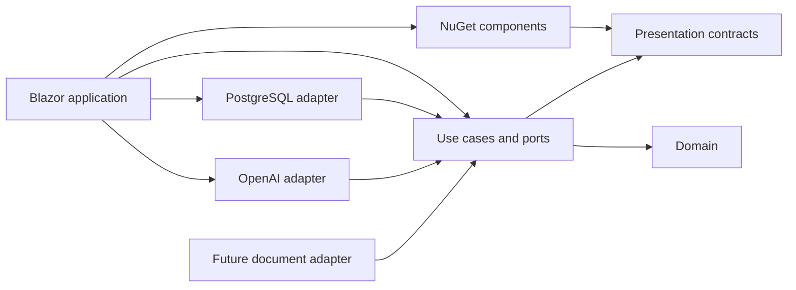

# Architecture — Marmotte.ChatUi

English | [Français](ARCHITECTURE.fr.md)

## Status and purpose

This document distinguishes the implemented M1–M3 foundations from the target product architecture. The nine source projects, an Interactive Server Blazor host, the domain and authorized use cases, and local Aspire infrastructure now exist. PostgreSQL/pgvector and Keycloak start with persistent data and readiness checks; ServiceDefaults supplies host diagnostics. Business persistence, OIDC sign-in, model adapters, reusable chat components, and NuGet publication remain planned; Web is not yet wired to the core.

Marmotte.ChatUi serves two purposes: a .NET and Blazor chat application inspired by AnythingLLM and Open WebUI, and a library of components and widgets that can be embedded in other applications. The complete application will use the same components distributed through NuGet.

## Scope and milestones

### First version

- Chat UI, conversations, messages, and streamed responses when supported by the server.
- Connection settings for OpenAI-compatible APIs: [LM Studio](https://lmstudio.ai/docs/app), [Unsloth Desktop](https://www.unsloth.ai/), and custom endpoints.
- Conversation history and preferences specific to each user.
- OIDC authentication for the complete application through Keycloak.
- Local orchestration with .NET Aspire, Keycloak, and PostgreSQL with pgvector.
- Reusable Blazor components intended for a NuGet package.
- A customizable design system with light, dark, and system modes.
- Attachment uploads through file selection and drag and drop; images sent to models that support vision.

### Next stage

PDF processing, particularly for scanned documents, is planned but may follow the first version. It will prepare page images, with page selection and resolution limits, before sending them to a vision model. A file type with no available processing must not be presented as usable by the model.

RAG, document indexing, and embedding generation are outside the first version. Having pgvector available prepares for those possible additions without implementing them. PostgreSQL is the only persistence provider selected for now; RavenDB is outside this scope.

## Architectural principles

Use a hexagonal architecture with a DDD-inspired domain. Use cases depend on internal ports; external technologies are adapters. The domain and application contracts do not depend on infrastructure tools or presentation components.

Important boundaries correspond to separate assemblies. The initial design is a modular application, without a requirement to deploy each assembly as a service.

### Target structure

All nine projects below exist under `src/`. The table describes their intended responsibilities. Domain, Contracts, and Application implement M2. The two business adapters and Components still establish boundaries without their future implementations. AppHost and ServiceDefaults implement M3 orchestration and diagnostics. Web references ServiceDefaults in addition to the dependencies listed below.

| Project / assembly | Responsibility | Main internal dependencies |
| --- | --- | --- |
| Marmotte.ChatUi.Domain | Conversations, messages, attachments, and business invariants | No infrastructure |
| Marmotte.ChatUi.Contracts | Presentation contracts and data exchanges required by the distributed components | No infrastructure |
| Marmotte.ChatUi.Application | Use cases, authorization, and ports for storage, identity, and generation | Domain, Contracts |
| Marmotte.ChatUi.Components | Razor Class Library, widgets, styles, and tokens; public NuGet package | Contracts |
| Marmotte.ChatUi.Infrastructure.OpenAI | Adapter for OpenAI-compatible servers | Application, Domain |
| Marmotte.ChatUi.Persistence.PostgreSql | Concrete repositories, mappings, migrations, and pgvector integration | Application, Domain |
| Marmotte.ChatUi.Web | Blazor application, OIDC sign-in, and composition of implementations | Components, Application, and adapters |
| Marmotte.ChatUi.AppHost | Definition and startup of Aspire resources | References to hosted projects |
| Marmotte.ChatUi.ServiceDefaults | Shared technical configuration for hosting and observability | No business rules |

Document processing may be placed in an Infrastructure.Documents assembly when implemented. The exact assembly structure for binary storage will be chosen at that stage, behind a dedicated port.



Arrows represent code dependencies. At runtime, use cases call adapters through injected interfaces.

## Domain model and contracts

M2 implements `Conversation` as an immutable aggregate owning ordered user/assistant message pairs and generation state. `Attachment` holds separately owned metadata; `ConnectionProfile` and `UserPreferences` are separate owned settings snapshots. GUIDs, UTC timestamps, revision checks, duplicate submission rules, and restoration validation preserve history. This is not yet a database schema.

The application exposes authorized creation, paging, loading, deletion, text submission, response recording/cancellation, and settings management. Current identity and repositories are ports; every operation derives ownership from trusted server identity and verifies returned owners. Profile secrets are absent from these contracts.

Conversation writes compare revisions and atomically commit messages and attachment references. Lists are bounded and ordered; full conversation loading currently materializes the whole history. Repository contracts expose no database types. Provider ports define capabilities and response streams, with no concrete model call or orchestrator yet. Binary storage and multimodal preparation ports remain for M9/M11.

See the [core reference](docs/core.md) for invariants, transitions, public APIs, cancellation, consistency, lifetimes, and limitations. Test adapters exercise this behavior without infrastructure; PostgreSQL guarantees and real user authentication remain to be verified in M4/M5.

## Blazor components and NuGet distribution

The library is a Razor Class Library intended for publication on NuGet. Its M1 scaffold references only Contracts and the browser-compatible Blazor component packages. A message list, message composer, attachments, generation states, and a composable chat widget are planned for M7. See [integration](docs/integration.md) for the rendering contract and current limitations.

Its API relies on stable parameters, events, templates, and presentation contracts. The consuming application supplies the conversation and attachment services it needs. The components do not require the complete application and do not mandate a database, identity provider, or model SDK.

Reusable assets and styles must ship with the library where needed. The widget host can replace the Marmotte.ChatUi application's branding. A sample project or consumption test will verify that the package works without transitive dependencies on server adapters.

NuGet publication is a later delivery milestone. No reserved package name, published version, or publication pipeline is assumed to exist.

## Host application and identity

The host uses ASP.NET Core Blazor with Interactive Server rendering and prerendering enabled for Routes and HeadOutlet. This keeps future model calls, secrets, and persistence on the server. Reusable components inherit the consuming host’s render mode and must not assume a server circuit. Static SSR supports display only; Interactive Server is the first interactive integration target. Interactive WebAssembly and Auto remain design targets requiring separate consumption tests before support is claimed.

Keycloak is the OIDC identity provider. Aspire starts its container as a separate resource, with reproducible realm, client, and redirect configuration. The application's OIDC client and the authority's public addresses must be consistent with what the browser can actually reach.

Authentication establishes identity; use cases then control access to each conversation, preference, and attachment. Persisted identity relies on a stable identifier associated with the OIDC issuer/subject pair, not an email address. An owner identifier supplied by the browser does not constitute authorization.

The local Keycloak configuration is not a production configuration. The hosting target and operational settings still need to be defined before a production deployment.

## Model connections

Settings cover the profile name, base URL, model, relevant options, and authentication when required by the server. Provide a connection test and model discovery where supported, with manual entry available.

The [OpenAI NuGet package](https://www.nuget.org/packages/OpenAI) is the preferred candidate requested for the adapter. The [official .NET SDK documents custom endpoints](https://github.com/openai/openai-dotnet#using-a-custom-base-url-and-api-key). Adoption will be confirmed by testing actual requirements against LM Studio and Unsloth Desktop; no version has been pinned or installed yet.

The SDK stays confined to Infrastructure.OpenAI. Its messages, results, and exceptions are translated into internal contracts. Verify chat, streaming, cancellation, model discovery, vision, and optional authentication separately. OpenAI compatibility alone does not imply the availability of the Responses or Files API.

Prefer the conversation subset actually shared by the target servers. An SDK credential requirement must not force users to invent a key in the settings when their local server does not require one; the technical approach will be verified and encapsulated in the adapter.

A profile belongs to its user and does not implicitly share its secrets with others. Model credentials are separate from OIDC sign-in to the application.

Account for the execution topology: localhost refers to the machine or container running the adapter, not necessarily the browser's computer. Document and test access to local servers from the chosen Aspire configuration.

## PostgreSQL persistence and pgvector

The Persistence.PostgreSql assembly contains all relational details: repository implementations, mappings, indexes, migrations, transactions, and provider-specific types. The choice between an ORM and direct SQL access remains open at this stage.

PostgreSQL stores conversations, messages, profiles, preferences, and attachment metadata. Binary storage has a separate port to avoid coupling the domain to a database or file system. The initial adapter and its retention policy will be defined when implementing uploads.

pgvector is an extension: it must be available in the PostgreSQL installation, then enabled in each database that uses it. M3 pins `pgvector/pgvector:0.8.7-pg17-bookworm` with a multi-platform digest and an explicit PostgreSQL 17 volume path. A short-lived initializer enables vector in `marmotte_chat` on every AppHost start, after database readiness and before Web:

```sql
CREATE EXTENSION IF NOT EXISTS vector;
```

This command enables an already installed extension; it does not install its files on the server. Installation and activation are described in the [official pgvector documentation](https://github.com/pgvector/pgvector#installation).

M3 checks activation on a new volume, idempotence on restart, and repair of an existing database after extension removal, while retaining application and identity probe data. The volume survives container shutdown. Business migrations remain M5 work; first-time image scripts do not replace them.

Embedding dimensions, models, vector indexes, and search rules will be decided alongside a feature that uses them. The initial chat does not require speculative embeddings or a search schema.

## Aspire orchestration

M3 starts `postgres`, databases `chatdb`/`keycloakdb`, the `database-init` container, `keycloak`, and `web`. PostgreSQL health gates database creation; database readiness gates initialization and Keycloak; successful vector activation and Keycloak readiness gate Web. The initializer has bounded connection, statement, and lock timeouts and a failing exit code on SQL errors. Hosting configuration stays outside the domain and component NuGet package.

One named PostgreSQL volume stores separate `marmotte_chat` and `marmotte_identity` databases. The local POC uses a shared administrator role; separate least-privilege production credentials are not implemented. Keycloak 26.6.4 is pinned by digest, uses its PostgreSQL database, and imports realm `marmotte` and confidential client `marmotte-web` only when the realm is absent. Local HTTP origins/redirects are explicit; automatic Keycloak HTTPS termination is disabled per resource so certificate availability cannot change the authority. The dashboard keeps HTTPS. Generated secret parameters persist in AppHost user secrets; only the relevant connection/client settings reach Web. OIDC handlers remain M4 work.

ServiceDefaults provides Development-only `/health` and `/alive`, service discovery, bounded HTTP defaults without retries, and optional OTLP metrics/traces. It configures no body/custom-header capture, SQL instrumentation, or log export. Web currently checks process health; ongoing adapter dependency checks remain future work. A Docker integration test validates fresh startup, repeated initialization, data retention, and browser-visible identity configuration. See [operations](docs/operations.md) for lifecycle, secrets, diagnostics, and limitations.

The Aspire documentation describes the [PostgreSQL](https://aspire.dev/integrations/databases/postgres/postgres-get-started/) and [Keycloak](https://aspire.dev/integrations/security/keycloak/) integrations. Orchestrated local startup is part of the first version. A production deployment target has not yet been selected.

## Attachments, vision, and PDFs

### Uploads and images

File selection and drag and drop use the same upload flow. Show the name, format, size, preview where relevant, progress, removal before sending, and understandable errors. Provide configurable limits per file and per message.

The application checks the actual format, size, dimensions, and access rights on the server. The provider contract exposes the necessary capabilities: a text-only model must not receive images that are silently ignored. Accepted formats and limits will be validated for each model and server; [LM Studio documents image input for vision models](https://lmstudio.ai/docs/typescript/llm-prediction/image-input).

Original attachments and prepared representations are distinct. References and metadata establish ownership, lifecycle, and traceability of the content actually sent.

### PDF preparation — later stage

The intended pipeline is: PDF validation, page inspection, selection of useful pages, rendering to images, suitable resizing and encoding, preview, then sending the selected pages to the vision model.

Rendering will be encapsulated behind a document preparation port. Set limits for pages, dimensions, total pixels, memory, time, and concurrency; process progressively instead of loading all pages into memory. Preserve page order and numbers. Handle invalid or protected files and cancellation explicitly.

For scanned PDFs, rendering to images is the main approach under consideration. For PDFs that already contain usable text, text extraction can be evaluated to avoid unnecessary conversion while retaining vision for layout, tables, or illustrations.

A PDF's size on disk does not measure its context consumption. Reducing JPEG size helps with transfer but does not guarantee a proportional reduction in visual tokens. Cost depends on the model, its preprocessing, dimensions, and the number of pages/images. Bound the content sent while preserving readability, and verify results with the target models.

The PDF rendering library, its license, and storage for rendered pages will be selected before this stage. No additional engine, OCR service, or queueing system is required by the current design.

## Design system and visual identity

The design system exposes semantic tokens through CSS custom properties: surfaces, text, accents, borders, states, focus, spacing, typography, radii, and shadows. Components use these tokens instead of individually hardcoded colors.

Provide light, dark, and system themes, with an explicit user preference. The consuming application must be able to override tokens globally or within a widget container, without modifying the package or imposing intrusive global styles. Check contrast, keyboard interaction, focus, and readability in every theme.

The brand reuses the turquoise mascot with a cream muzzle and red scarf supplied by the user. A Marmotte.ChatUi banner is used in the README, and a compact version is intended for the application. Widget consumers can customize its branding. MarmotteDB and Experimental Proof of Concept belong to the original references and are not the product name.

Reference images and their provenance are preserved in [docs/images/README.md](docs/images/README.md). Assets must work on light and dark backgrounds and preserve transparency where present.

## Verification during implementation

- Verify assembly independence and NuGet consumption in a minimal application.
- Test invariants, isolation between users, and repository operations.
- Verify migrations and pgvector activation on new and existing databases.
- Test OIDC sign-in and access to protected resources.
- Validate chat, streaming, cancellation, and images against the servers and models actually selected.
- Check themes, overridden tokens, keyboard interaction, and upload states.
- Once the PDF pipeline exists, check scanned documents, limits, cancellation, readability, and resource consumption.

## Decisions to finalize

.NET 10, Aspire 13.6.5, the pinned dependencies, and Interactive Server rendering are selected in M1; see the [development guide](docs/development.md) and [operations guide](docs/operations.md). Data access, binary storage, the PDF rendering engine, and the production target will be specified during their respective implementation stages. These open points do not change the dependency boundaries, PostgreSQL, pgvector, OIDC/Keycloak, or NuGet distribution of the components.
