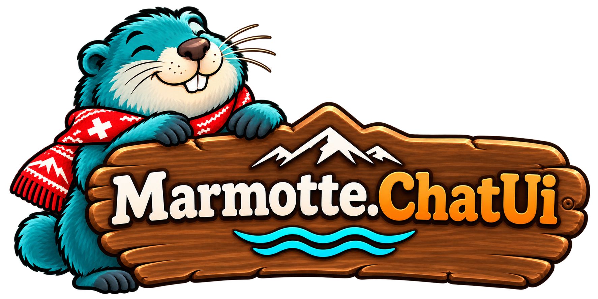

# Marmotte.ChatUi

[English](README.md) | Français



Une application de chat en .NET et Blazor, et des composants réutilisables pour intégrer conversations et widgets de chat dans d’autres applications.

## État du projet

> **Preuve de concept (POC) expérimentale — non prête pour la production.**
> Ce projet est destiné à l’expérimentation et à l’évaluation, pas à un usage en production.


Les milestones 1 à 5 sont implémentés : socle .NET 10/Blazor, domaine et cas d’usage autorisés, infrastructure locale Aspire, connexion/déconnexion OIDC avec Keycloak et isolation utilisateur. Web fournit un accueil public et un espace protégé. PostgreSQL persiste désormais historique, paramètres, métadonnées de pièces jointes et secrets de modèle protégés, via EF Core en code first et migrations au démarrage. L’adaptateur texte M6 est implémenté et testé avec LM Studio ; les validations Unsloth et vision restent ouvertes. M7 ajoute les composants de chat réutilisables, les tokens sémantiques, les thèmes clair/sombre/système et un exemple interactif indépendant. L’intégration complète modèle/historique suit en M8. Aucun package NuGet n’est publié.

## Direction du produit

- Composants Blazor destinés à être distribués en NuGet.
- Chat et paramètres de connexion aux API compatibles OpenAI, dont LM Studio et Unsloth Desktop.
- SDK .NET OpenAI 2.15.0 isolé dans l’adaptateur de modèles.
- Historique et préférences utilisateur dans PostgreSQL, avec pgvector disponible.
- Application complète avec authentification OIDC/Keycloak et orchestration .NET Aspire.
- Design system personnalisable, modes clair et sombre, uploads et glisser-déposer d’images.
- Préparation de PDF pour les modèles de vision prévue dans une étape ultérieure.

## Documentation

- [Roadmap et tâches par milestone](roadmap.fr.md)
- [Architecture et périmètre](ARCHITECTURE.fr.md)
- [Modèle métier, ports et cas d’usage](docs/core.fr.md)
- [PostgreSQL, migrations et clés de protection](docs/persistence.fr.md)
- [Adaptateur de modèles, configuration et compatibilité](docs/models.fr.md)
- [Composants réutilisables, exemple et tokens de thème](docs/integration.fr.md)
- [Consignes de contribution](AGENTS.fr.md)
- [Mascotte et provenance des images](docs/images/README.fr.md)

## Compiler et démarrer

Installer le SDK .NET sélectionné par [global.json](global.json) : `10.0.401` ou un correctif ultérieur de la même bande `10.0.4xx`. La première restauration nécessite un accès à NuGet. L’hôte autonome et les tests courants ne nécessitent ni Docker ni identifiants de modèles. L’infrastructure locale complète nécessite un moteur compatible Docker démarré.

Depuis la racine du dépôt :

```sh
dotnet restore Marmotte.ChatUi.slnx --locked-mode
dotnet build Marmotte.ChatUi.slnx --configuration Release --no-restore
dotnet format Marmotte.ChatUi.slnx --verify-no-changes --no-restore
dotnet test --solution Marmotte.ChatUi.slnx --configuration Release --no-build --no-restore
dotnet run --project src/Marmotte.ChatUi.Web --configuration Release --no-build
```

Ouvrir [l’hôte local](http://localhost:5180). La page affiche l’état du projet et la mascotte ; elle ne propose pas encore de chat. L’arrêter avec Ctrl+C.

Essayer le studio de composants indépendant, avec streaming simulé et sans services externes :

```sh
dotnet run --project samples/Marmotte.ChatUi.Sample --configuration Release --no-build
```

Ouvrir [l’exemple](http://127.0.0.1:5190). Il démontre sélection de thème, personnalisation, annulation, erreurs et métadonnées de pièces jointes.

Pour démarrer l’infrastructure et la connexion OIDC avec Docker actif :

```sh
dotnet run --project src/Marmotte.ChatUi.AppHost --configuration Release --no-build
```

Aspire démarre PostgreSQL, l’initialisation pgvector, Keycloak, Web et [pgAdmin dans le navigateur](http://localhost:5050), préconfiguré pour PostgreSQL. Ouvrir son lien authentifié de tableau de bord ; les données de base et d’identité survivent à Ctrl+C et au redémarrage. Consulter [l’exploitation](docs/operations.fr.md) pour créer des utilisateurs locaux, se connecter et configurer les ports, secrets et volumes existants.

Consulter le [guide de développement](docs/development.fr.md) pour les versions, conventions et tests ; [l’exploitation](docs/operations.fr.md) pour le démarrage Aspire et les secrets de développement ; et [l’intégration](docs/integration.fr.md) pour les frontières des composants et les choix de rendu.
