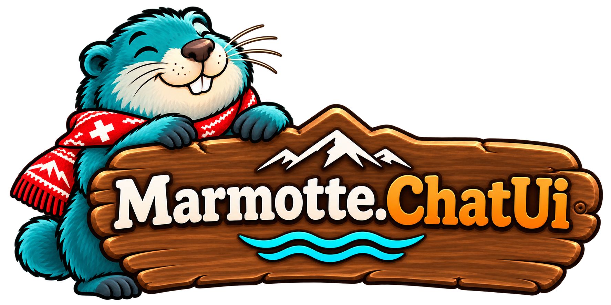
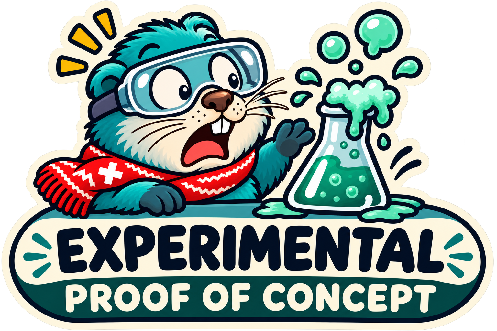

# Marmotte.ChatUi

English | [Français](README.fr.md)



A .NET and Blazor chat application, with reusable components for embedding conversations and chat widgets in other applications.

## Project status

> **Experimental proof of concept (POC) — not production-ready.**
> This project is intended for experimentation and evaluation, not production use.



Milestones 1 through 5 are implemented: .NET 10/Blazor foundations, the domain and authorized use cases, local Aspire infrastructure, and OIDC sign-in/sign-out with Keycloak and user isolation. Web provides a public landing page and a protected workspace. PostgreSQL now persists history, settings, attachment metadata, and protected model credentials, using EF Core code first and startup migrations. The M6 text model adapter is implemented and tested against LM Studio; Unsloth and vision validation remain open. Reusable chat components remain for later milestones. No NuGet package has been published.

## Product direction

- Blazor components intended for distribution through NuGet.
- Chat and connection settings for OpenAI-compatible APIs, including LM Studio and Unsloth Desktop.
- OpenAI .NET SDK 2.15.0 isolated inside the model adapter.
- Conversation history and user preferences in PostgreSQL, with pgvector available.
- A complete application with OIDC/Keycloak authentication and .NET Aspire orchestration.
- A customizable design system, light and dark modes, and image uploads through file selection and drag and drop.
- PDF preparation for vision models planned for a later stage.

## Documentation

- [Roadmap and numbered milestones](roadmap.md)
- [Architecture and scope](ARCHITECTURE.md)
- [Domain model, ports, and use cases](docs/core.md)
- [PostgreSQL, migrations, and credential keys](docs/persistence.md)
- [Model adapter, configuration, and compatibility](docs/models.md)
- [Contribution guidelines](AGENTS.md)
- [Mascot and image provenance](docs/images/README.md)

## Build and run

Install the .NET SDK selected by [global.json](global.json): `10.0.401` or a newer patch in the same `10.0.4xx` feature band. NuGet access is required for the first restore. The standalone host and routine tests need neither Docker nor model credentials. The complete local infrastructure requires a running Docker-compatible engine.

Run from the repository root:

```sh
dotnet restore Marmotte.ChatUi.slnx --locked-mode
dotnet build Marmotte.ChatUi.slnx --configuration Release --no-restore
dotnet format Marmotte.ChatUi.slnx --verify-no-changes --no-restore
dotnet test --solution Marmotte.ChatUi.slnx --configuration Release --no-build --no-restore
dotnet run --project src/Marmotte.ChatUi.Web --configuration Release --no-build
```

Open [the local host](http://localhost:5180). The page displays the project status and mascot; it does not yet provide chat. Stop it with Ctrl+C.

To start the infrastructure and OIDC sign-in with Docker running:

```sh
dotnet run --project src/Marmotte.ChatUi.AppHost --configuration Release --no-build
```

Aspire starts PostgreSQL, pgvector initialization, Keycloak, Web, and [pgAdmin in the browser](http://localhost:5050) with PostgreSQL preconfigured. Open its authenticated dashboard link; database and identity data survive Ctrl+C and restart. See [operations](docs/operations.md) to create local users, sign in, and configure ports, secrets, and existing volumes.

See the [development guide](docs/development.md) for pinned dependencies, conventions, and test coverage; [operations](docs/operations.md) for Aspire startup and development secrets; and [integration](docs/integration.md) for component boundaries and rendering decisions.
